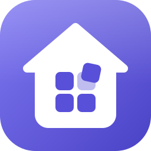
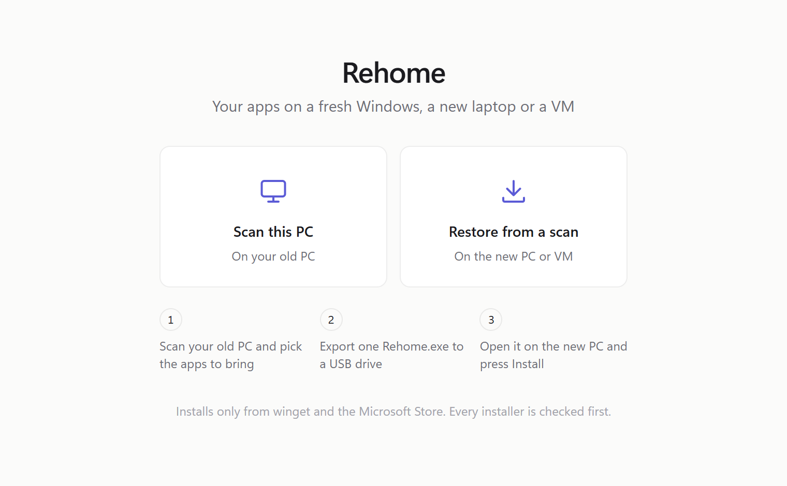
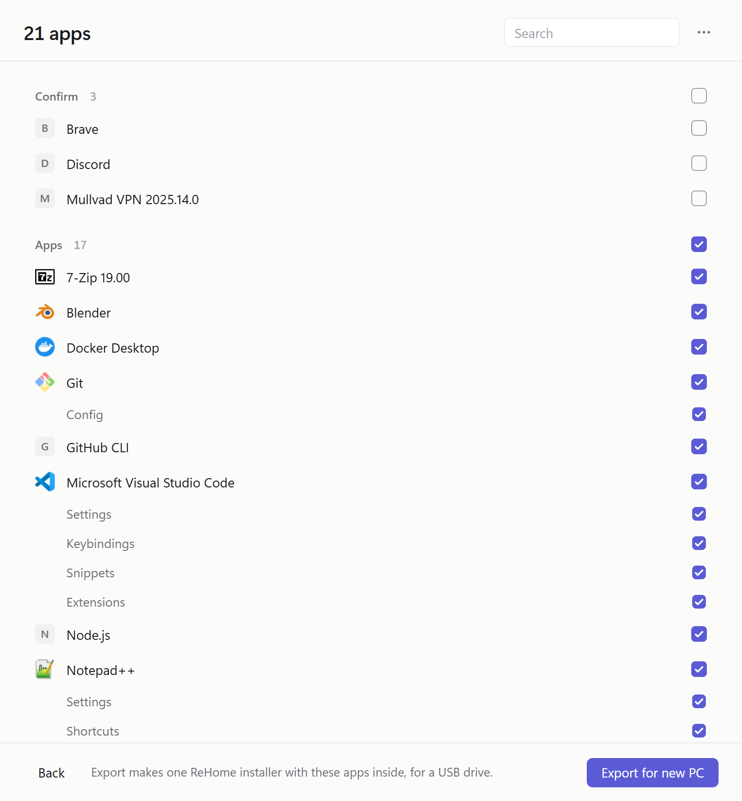
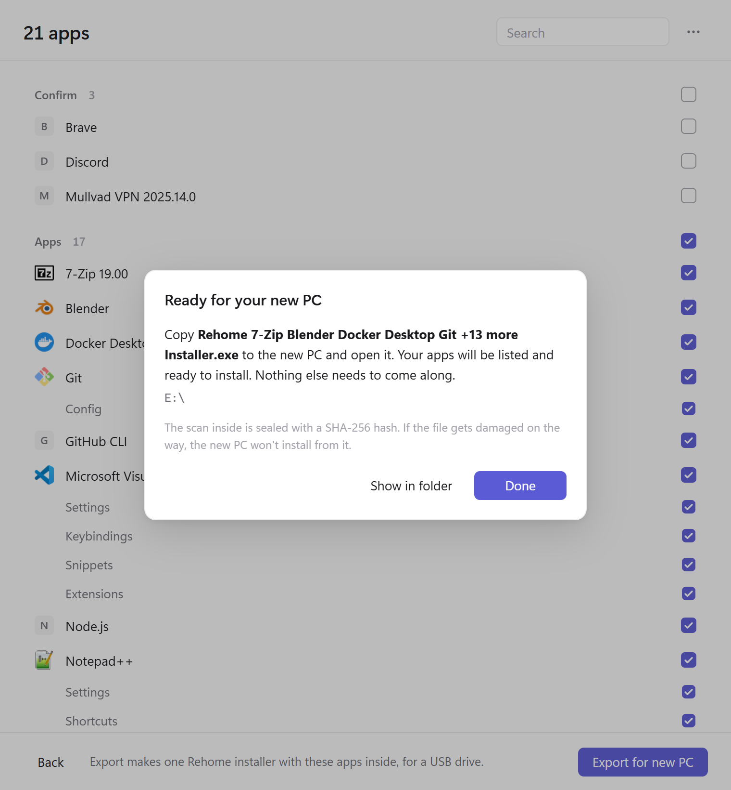
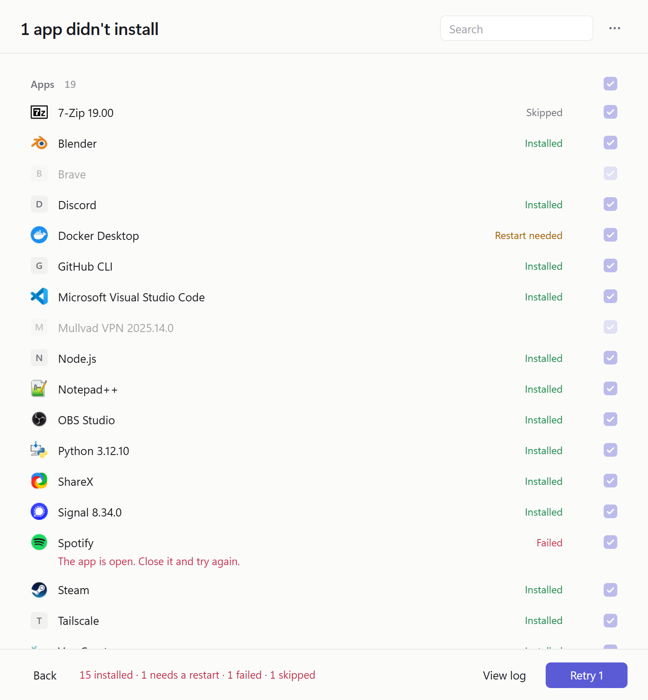
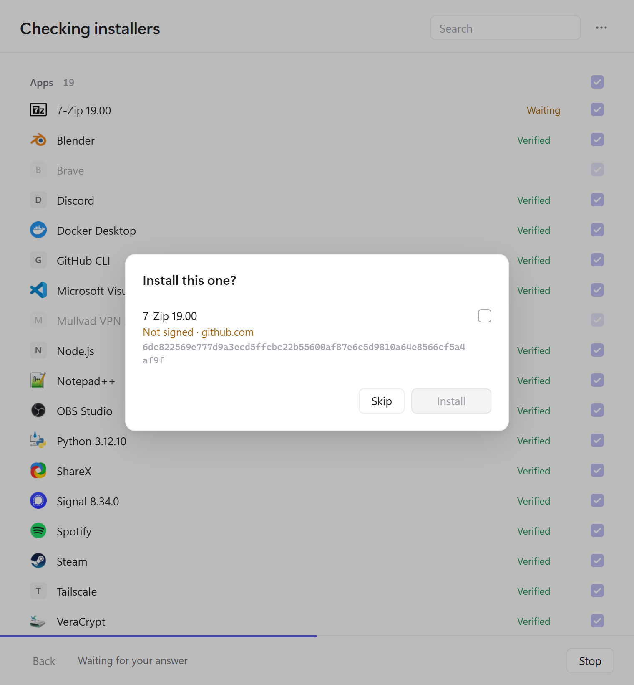

<div align="center">



# ReHome

**Your apps on a fresh Windows, a new laptop or a VM.**

Scan the old PC, carry one exe over on a USB drive, press Install.<br>
Every app comes from winget or the Microsoft Store, and every installer is checked before it runs.

[](https://github.com/mil-orb/ReHome/actions/workflows/ci.yml)


[](https://github.com/mil-orb/ReHome/releases/latest)
[](LICENSE)

<picture>
  <source media="(prefers-color-scheme: dark)" srcset="docs/images/start-dark.png">
  
</picture>

</div>

## Why ReHome

- **No installer hunting.** Each app on the old PC is matched to its exact winget or Microsoft Store package, so there are no vendor sites to search and no setup wizards to click through.
- **One admin prompt for the whole list.** Approve it once and leave it running. ReHome only stops again if an installer fails a check, and apps already on the new PC are skipped.
- **Nothing to set up first.** No account, no cloud sync, no agent to install. The exported exe carries both the program and your list, so the new PC needs only Windows.
- **A clear result for every app.** Each one ends as installed, needs a restart, or failed with a plain sentence saying why and what to try. Retry is one click.
- **Your list stays with you.** ReHome has no server and uploads nothing. The scan goes wherever you save it, and the only network traffic is winget talking to Microsoft's catalogs.

The catch: apps no official catalog carries get a link to the vendor's page instead of an install, and settings don't move yet. See [Limits](#limits).

## How it works

<table>
<tr>
<td width="33%" valign="top">

**1. Scan the old PC**

ReHome lists what's installed and matches each app to its exact winget or Store package. Drivers, runtimes and apps Windows ships with are sorted out of the way. Untick anything you don't want.

</td>
<td width="33%" valign="top">

**2. Export one exe**

**Export for new PC** writes a single `ReHome 7-Zip Blender Docker Desktop Git +13 more Installer.exe` with your list sealed inside. About 59 MB. Copy it to a USB drive.

</td>
<td width="33%" valign="top">

**3. Open it on the new PC**

Your apps are listed and ticked. Press Install, approve one admin prompt, and ReHome checks each installer, then installs it. Apps already there are skipped. At the end it says what installed, what needs a restart, and why anything didn't.

</td>
</tr>
<tr>
<td><picture><source media="(prefers-color-scheme: dark)" srcset="docs/images/scan-dark.png"></picture></td>
<td><picture><source media="(prefers-color-scheme: dark)" srcset="docs/images/export-dark.png"></picture></td>
<td><picture><source media="(prefers-color-scheme: dark)" srcset="docs/images/done-dark.png"></picture></td>
</tr>
</table>

Nothing to install on either side. The same exe scans on the old PC and installs on the new one. If ReHome is already open on the new PC, drop the exported installer on its window.

## What it checks

Before anything runs as administrator, each installer is downloaded unelevated and checked:

| Check | What it proves |
|---|---|
| Source is `winget` or `msstore` | The package is in Microsoft's own catalogs. Sources added with `winget source add` are ignored. |
| SHA-256 matches the manifest | These are the bytes winget-pkgs reviewed. A mismatch never installs and can't be overridden. |
| Signer matches the old PC's | The same company signed it. A changed or missing signature stops and asks. |
| Certificate not revoked | Windows checks the whole signing chain online. Revoked or distrusted never installs. |
| Exact version, scope and architecture | winget installs that same release and checks its hash against the manifest again. |

<picture>
  <source media="(prefers-color-scheme: dark)" srcset="docs/images/review-dark.png">
  
</picture>

An unsigned installer, or one signed by a different company than before, stops and asks with nothing preselected. Apps no official catalog carries (RustDesk, VMware Workstation) are listed with a link to the vendor's page; ReHome never downloads those itself.

The full list of checks, and the gaps that are still open, is in [docs/security-model.md](docs/security-model.md).

## Get it

Download `ReHome.exe` from the [latest release](https://github.com/mil-orb/ReHome/releases/latest). It's one portable file with nothing to install. To check the download against the release's `SHA256SUMS.txt`:

```powershell
(Get-FileHash .\ReHome.exe -Algorithm SHA256).Hash
```

The exe isn't code-signed yet, so Windows SmartScreen shows "Windows protected your PC" the first time. Choose **More info**, then **Run anyway**. The installer you export for your new PC doesn't get the warning, since it's written on your own PC.

To build it yourself instead:

```powershell
git clone https://github.com/mil-orb/ReHome
cd ReHome
dotnet publish src/Rehome.App -c Release -o out   # out\ReHome.exe
```

Needs the .NET 10 SDK (10.0.300) and Node 22+. Full setup in [BUILD.md](BUILD.md).

**On the new PC** ReHome needs the WebView2 Runtime (in Windows 11 and current Windows 10) and App Installer, which provides winget. Both come with Windows.

## Command line

`rehome.exe` (from `dotnet publish src/Rehome -c Release`) does the same jobs without a window, for scripts, agents and Windows Sandbox:

```
rehome scan                    # readable list
rehome scan -o scan.json       # sealed JSON for scripts and agents
rehome verify scan.json        # download and check every installer, install nothing
rehome install scan.json       # check, then install; asks about anything unusual
rehome install scan.json --yes # unattended: installs only what passes every check
```

Piped output is JSON lines; the human summary goes to stderr. Exit codes: `0` all good, `1` something failed, `2` bad arguments, `130` stopped with Ctrl+C. Set `REHOME_TRACE=1` for per-step timings.

## Troubleshooting

**"winget isn't available" or "winget isn't responding"**. On a brand-new Windows, App Installer can take a few minutes to register after first sign-in. Open the Microsoft Store, update App Installer, and try again.

**"This scan was changed or damaged after it was saved"**. The file didn't arrive intact, usually a half-finished copy to the USB drive. Export again on the old PC.

**An app shows "Failed" with "The app is open"**. Close it and press Retry.

**"ReHome couldn't set up its copy in your app data folder"**. ReHome only asks for admin rights from its own copy in `%LOCALAPPDATA%\Rehome\App`. Check the system drive has about 100 MB free, then close ReHome and open it again.

**Something else**. The log is at `%LOCALAPPDATA%\Rehome\rehome.log` (**⋯ > Preferences > Show in Explorer**, or **Open log** on any error message). It lists app names, package ids and each check's result, never settings contents. Attach it to a [bug report](https://github.com/mil-orb/ReHome/issues/new/choose).

## Limits

- Restore installs the latest version in the catalog, not the one the old PC had.
- Each installer downloads twice (once to check, once to install), so a restore uses about twice the bandwidth.
- Settings are listed but not carried yet. That needs the encrypted package, which isn't built.
- Windows only, x64.

## More

- [How it works](docs/how-it-works.md): what a scan includes and leaves out, sealed scans, the portable exe
- [Security model](docs/security-model.md): every check, the elevated helper, known gaps
- [Architecture](docs/architecture.md): projects, files, the UI bridge, scan format, invariants
- [Building](BUILD.md) and [contributing](CONTRIBUTING.md)
- [AGENTS.md](AGENTS.md) for coding assistants working in this repo
- [Reporting a security problem](SECURITY.md)

## License

[MIT](LICENSE). Use and change it however you like, as long as the copyright notice stays with it.
