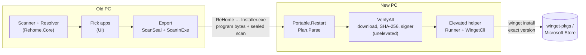

# Architecture

Three projects share one core. The CLI and the desktop app are thin; anything that decides what's on a PC, what to install or whether to trust it lives in `Rehome.Core`, where it's unit tested.



## Projects

| Project | What it is | Depends on |
|---|---|---|
| `src/Rehome.Core` | Scanning, matching, scan format, restore planning, verification, install runner. No UI. | winget COM interop (`Microsoft.WindowsPackageManager.ComInterop`) |
| `src/Rehome` | `rehome.exe`, the CLI. Argument parsing and printing only. | Core |
| `src/Rehome.App` | `ReHome.exe`, the desktop app: a Win32 window hosting WebView2, a message bridge, the elevated helper, portable start. Published with NativeAOT. | Core, WebView2 (its loader only, linked in) |
| `src/Rehome.App/ui` | React 19 + Vite UI, compiled into the exe as embedded resources. | npm, pinned and locked |
| `tests/Rehome.Tests` | xUnit tests for Core. No winget calls, no registry writes, no network. | Core |

## Files worth knowing

```
src/Rehome.Core/
  Model.cs            Snapshot, App, CatalogRef, Signer, Status: the scan format
  Scanner.cs          Scan entry point: inventory, then Resolver, then settings probe
  Scan/Inventory.cs   Installed apps from the registry, MSIX packages and winget correlation
  Scan/Authenticode.cs  WinVerifyTrust wrapper; the signer's organization and whether it's valid
  Resolver.cs         Installed app -> group (Apps, Store, Confirm, vendor site, drivers, Steam) and package. Pure
  Categories.cs       Drivers, runtimes and Windows parts. Pure
  WindowsApps.cs      Apps Windows installs itself, left out. Pure given the provisioned set
  Settings.cs         Settings catalog, file probe, secret check
  Selection.cs        What the person ticked, applied to a scan
  ScanSeal.cs         SHA-256 seal written into the scan's own "check" field
  ScanInExe.cs        Scan appended to an exe: [program][scan][int64 length]["REHOMESC"]
  ExportName.cs       "ReHome 7-Zip Brave VLC Installer.exe"
  Restore/Plan.cs     Opening a scan: seal check, allowlists, cleaning. All scan input passes here
  Restore/Verify.cs   One installer: download via winget, SHA-256 vs manifest, signer vs scan -> Verdict
  Restore/VerifyAll.cs  Verifies many in parallel, owns the Downloads folder
  Restore/Install.cs  WingetCli: exact winget arguments, and the trusted winget.exe path
  Restore/Runner.cs   Install loop shared by the CLI and the elevated helper; RunEvent stream
  Restore/Errors.cs   winget HRESULTs -> sentences a person can act on
src/Rehome.App/
  Program.cs          Entry: elevated helper, portable restart, crash handlers, window
  Portable.cs         Relocation to %LOCALAPPDATA%\Rehome\App\<hash>\ so winget's winmd sits beside the exe; the only place it elevates from
  Window.cs           The window and its message loop. WebView2 locked to https://app.rehome.internal/ served from resources
  Native/WebView2.cs  WebView2's COM interfaces, source-generated. Slot order follows WebView2.idl
  Native/Win32.cs     Window, message and DPI calls
  Native/Dialogs.cs   Open and Save dialogs, message boxes
  Native/IconPng.cs   An icon from a file as PNG bytes
  app.manifest        Per-monitor DPI, current-style controls, runs as the invoker
  Bridge.cs           Every message the page can send, and the log
  Elevated.cs         Both ends of the named pipe to the elevated helper
  AppIcons.cs         Icons from installed files, as PNG data URIs
src/Rehome.App/ui/src/
  App.tsx             Start screen, menu, dialogs, screen changes, error boundary
  ScanView.tsx        Old PC: the app list and Export
  RestoreView.tsx     New PC: steps, install list, row progress, review dialog, outcome
  notices.tsx         Every message the window shows: cards that close themselves, errors that stay
  drop.tsx            Drop the exported installer on the window to restore from it
  brand.tsx           The logo, drawn inline (same shapes as assets/logo.svg)
  Footer.tsx          The bottom bar: Back, what's happening, the next step, progress
  list.tsx            Grouped, searchable list shared by both views
  bridge.ts           Typed calls to the host, plus a simulated host for `npm run dev`
  types.ts            TypeScript mirror of Model.cs
src/Rehome.App/ui/scripts/
  screenshots.mjs     npm run screenshots: README images from the dev UI
  icon.mjs            npm run icon: Rehome.ico from assets/logo.svg and logo-small.svg
  edge.mjs            Headless Edge over DevTools, used by both. No packages
assets/
  logo.svg            The mark, 32 px and up
  logo-small.svg      The 16 to 24 px version
```

## The bridge

The page never touches the machine. It sends `{ id, method, params }` through `window.chrome.webview.postMessage`; `Bridge.cs` answers with `{ id, result }` or `{ id, error }`, where `error` is a sentence to show. Long work (scan, verify, install) pushes events without an id.

Methods: `boot`, `scan`, `icons`, `export`, `showExport`, `open`, `openDropped`, `present`, `install`, `decide`, `stop`, `link`, `about`, `setPreferences`, `showLog`, `log`.

The page refers to apps by `localId` only. The host looks each one up in its own copy of the scan, so the page can't hand the host a package id, a URL or a path. To add a method, change four places together:

1. `Bridge.cs`: the `switch` in `Handle` and the method.
2. `ui/src/bridge.ts`: the `Methods` interface.
3. `ui/src/bridge.ts`: the simulated host in `dev()`, so `npm run dev` keeps working.
4. The "desktop app" list in [security-model.md](security-model.md#the-desktop-app).

## Scan format

A scan is UTF-8 JSON, camelCase, `format: 1`. Fields added within format 1 are optional so older readers ignore them.

```jsonc
{
  "format": 1,
  "machine": "DEMO-PC",
  "taken": "2026-11-10T12:00:00-05:00",
  "winget": "1.29.380",
  "apps": [{
    "name": "Git", "publisher": "The Git Development Community", "version": "2.52.0",
    "localId": "ARP\\Machine\\X64\\Git_is1",          // identity on the old PC; the UI refers to apps by this
    "status": "Ready",                                  // Ready, Guess, Manual, Launcher, Companion
    "package": { "id": "Git.Git", "source": "winget" }, // or "msstore"
    "signer": { "organization": "Johannes Schindelin", "valid": true, "from": "exe" },
    "settings": [{ "id": "config", "label": "Config", "files": [{ "path": "{Home}\\.gitconfig", "size": 1024 }] }],
    "icon": "data:image/png;base64,…"
  }],
  "check": "<64 hex chars: SHA-256 of these bytes with this value zeroed>"
}
```

`src/Rehome.App/ui/dev/fixture.json` is a full example.

## Rules the code keeps

These are the invariants a change must not break. Each has tests or a single choke point.

| Rule | Where it's enforced |
|---|---|
| Only `winget` and `msstore` sources, and ids matching `^[A-Za-z0-9][A-Za-z0-9.+_-]{0,127}$` | `Plan.IsInstallable`, again in `WingetCli` and in the elevated helper |
| Scan values never pass through a shell | `ProcessStartInfo.ArgumentList` in `WingetCli.Run` |
| A hash mismatch never installs and can't be overridden | `Verify.cs`; `--ignore-security-hash` and `--force` appear nowhere |
| A sealed scan that doesn't match is refused before anything is listed | `Plan.Parse` |
| The elevated helper starts only App Installer's own, Microsoft-signed `winget.exe` | `WingetCli.Path`, `WingetPathTests` |
| The elevated helper writes no files | `Elevated.Serve` sends `helper-error` events instead |
| Settings files with secrets stay behind | `Secrets.Found` in `Settings.cs`, `SettingsTests` |
| Links are https with a host and no user info; catalog links are rebuilt from the id | `Links.Https`, `Links.CatalogPage` |

## Where data lives

On any PC ReHome runs on, everything is under `%LOCALAPPDATA%\Rehome`: `preferences.json`, `rehome.log`, `Downloads\` (installers being checked), `App\<hash>\` (the portable copy), and the WebView2 profile. Nothing in the registry.
